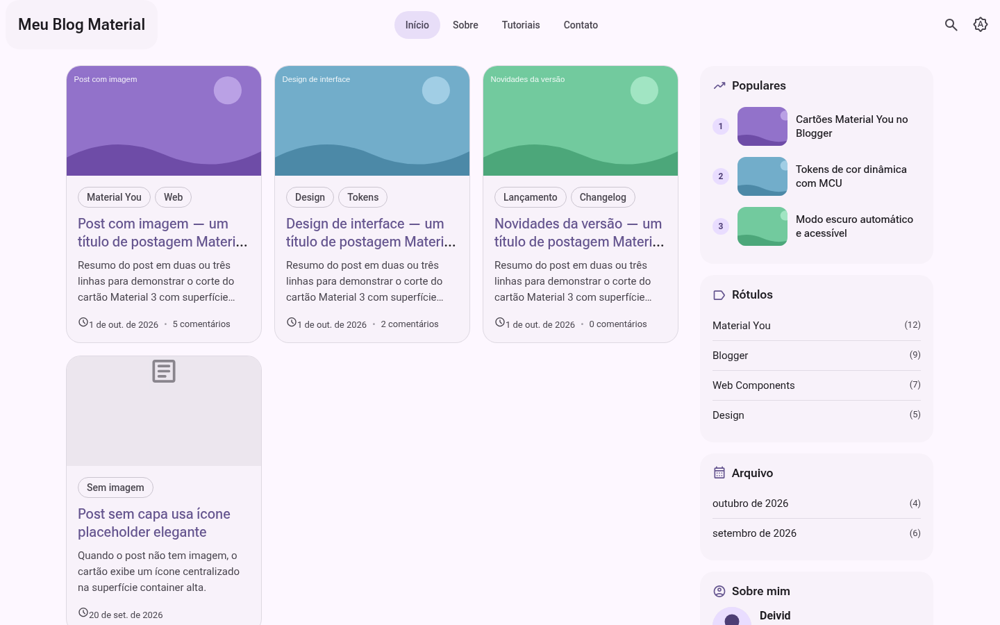
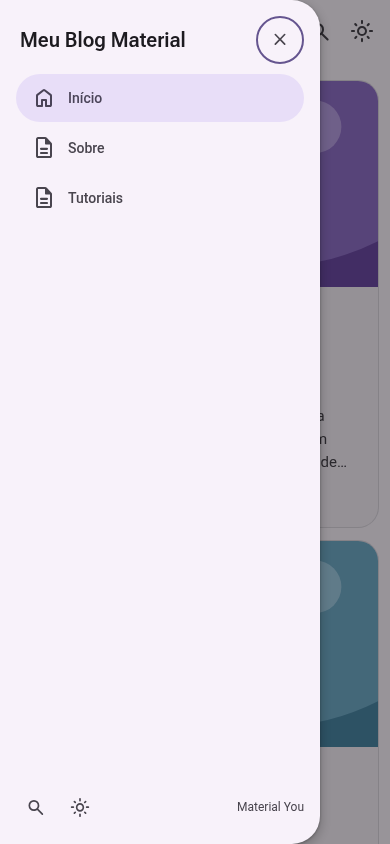
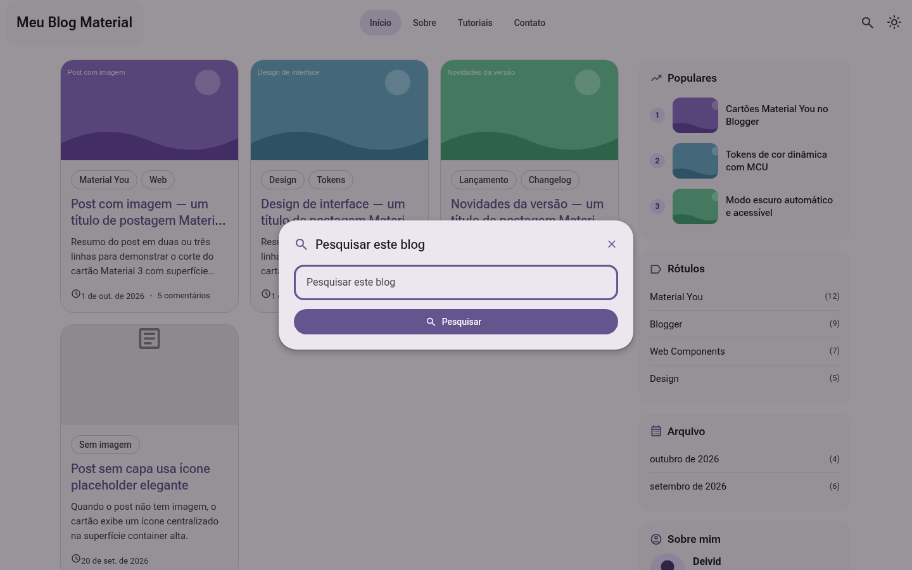

# Blogger Material You

[](https://github.com/deivid22srk/blogger-material-you/actions/workflows/build.yml)

Tema **Material You (Material 3)** completo para o **Blogger**, com cor dinâmica,
modo claro/escuro/automático e componentes [Material Web](https://github.com/material-components/material-web).

> Documentação de pesquisa e decisões: [`docs/NOTAS.md`](docs/NOTAS.md)

| Claro | Escuro |
|---|---|
|  |  |

| Drawer mobile | Busca em modal M3 |
|---|---|
|  |  |


## ✨ Recursos

- 🎨 **Cor dinâmica Material You** — o esquema de cores completo (claro e escuro)
  é gerado no navegador a partir de uma **cor semente** com
  `@material/material-color-utilities` (HCT/tonal palettes do Material 3).
- 🌗 **Claro / escuro / automático** — botão no app bar cicla os modos, salva em
  `localStorage` e respeita `prefers-color-scheme`. Sem flash de tema errado
  (script de boot antes da primeira pintura).
- 🧩 **Componentes Material Web reais** (`@material/web@2`) — botões, FAB, ícones,
  Material Symbols, text field, circular progress; bundle único minificado.
- 🖼️ **Home em grade de cartões** — capa 16:9, chips de rótulos, resumo, data e
  contagem de comentários; cartão sem capa usa placeholder com ícone.
- 📝 **Post confortável** — tipografia Roboto Flex, tabelas/código/blockquote
  estilizados, chips de rótulos, autor, **compartilhamento** (Web Share API +
  WhatsApp/X/Telegram/e-mail/cópia), **posts relacionados** por rótulo via feed
  JSON e **tempo de leitura**.
- 💬 **Comentários nativos threadados** do Blogger, seguindo o fluxo oficial
  (`commentPicker` → `threadedComments`/`comments`/`iframeComments`).
- 🔍 **Busca em modal M3**, navegação em abas no desktop e **drawer** no mobile,
  FAB “voltar ao topo”, 404 com estilo próprio, paginação com botões M3.
- ⚡ **Performance/SEO** — CSS integral no `<b:skin>` (funciona até sem JS),
  lazy loading de imagens, `preconnect` de fontes, Open Graph/Twitter Card,
  widgets com markup próprio (âncoras reais, bom para SEO).
- ♿ Acessível — skip link, foco visível, ARIA, contraste M3,
  `prefers-reduced-motion` e estilo de impressão.

## 📥 Instalação no Blogger

1. **Faça backup do seu tema atual!**
   Painel do Blogger → **Tema** → seta ao lado de “Personalizar” →
   **Fazer backup** → salve o XML.
2. Baixe o [`theme.xml`](https://deivid22srk.github.io/blogger-material-you/theme.xml)
   (ou dos artefatos da execução do workflow).
3. Ainda em **Tema** → seta ao lado de “Personalizar” → **Restaurar** →
   **Fazer upload** → selecione `theme.xml` → confirme.

O `theme.js` (componentes Material Web + cor dinâmica) é carregado
automaticamente do GitHub Pages deste repositório — nada mais para configurar.

## 🎛️ Personalizações

| O quê | Onde |
|---|---|
| **Cor semente (seed color)** | Tema → **Personalizar** → **Avançado** → “Material You — cores” → *Cor semente (Material You)*. Todo o esquema (primária, superfícies, containers…) é recalculado no ato. |
| Fontes do texto/título | Avançado → “Tipografia” (as variáveis `body.font` e `blog.title.font`). |
| Claro/escuro/auto | Botão de luna/sol no app bar (visitante); padrão inicial = automático. |
| Widgets | Layout → arraste gadgets para as seções “Barra lateral”, “Rodapé — links”, “Rodapé — conteúdo” (gadgets adicionados via Layout herdam o estilo `.widget`). |
| Menu de páginas | Layout → “Menu de páginas” (PageList) e “Menu mobile” (drawer). |

Variáveis do Designer incluídas: `keycolor` (cor semente), `body.font`,
`blog.title.font`.

## 🗂️ Estrutura

```
blogger-material-you/
├── .github/workflows/build.yml   # build + validação + GitHub Pages
├── docs/NOTAS.md                 # pesquisa (Fase 1) e decisões técnicas
├── scripts/
│   ├── gen-tokens.mjs            # tokens M3 fallback (esquema claro+escuro)
│   ├── build-theme.mjs           # monta e valida o dist/theme.xml
│   ├── validate-xml.mjs          # validador estrutural (usado no CI)
│   ├── preview.mjs               # harness visual local
│   └── pages-index.mjs           # índice do GitHub Pages
├── src/
│   ├── theme.template.xml        # tema Blogger (placeholders → dist/theme.xml)
│   ├── main.js                   # imports @material/web + comportamentos
│   ├── color.js                  # cor dinâmica + modo claro/escuro/auto
│   └── styles.css                # tokens M3 + layout + componentes
├── dist/                         # gerado: theme.xml, theme.js, index.html
├── vite.config.js
└── package.json
```

## 🛠️ Desenvolvimento

```bash
npm install
npm run build      # theme.js (Vite) + tokens (MCU) + theme.xml (validado)
npm run preview    # harness visual em http://localhost:4173
npm run validate   # valida dist/theme.xml
```

Requisitos: Node 20+. O build roda no GitHub Actions a cada push em `main`
(ou manualmente em *Actions → Build Blogger Theme → Run workflow*); o resultado
é publicado no GitHub Pages e como artefato da execução.

## ⚠️ Limitações conhecidas

- `@material/web` está em **maintenance mode** (ver `docs/NOTAS.md` §2.1);
  o tema usa apenas componentes maduros e reduz o acoplamento com CSS próprio.
- Cartões, drawer, abas e modal de busca são marcação própria com tokens M3
  (o pacote estável não tem cards/navigation; âncoras reais também favorecem SEO).
- O esquema de cores gerado no cliente exige JavaScript; **sem JS** o tema usa
  os tokens de fallback embutidos no `<b:skin>` (semente padrão `#6750a4`).
- BlogArchive no modo hierárquico renderiza como lista simples (flat/menu
  suportados nativamente).
- Widgets `FeaturedPost` e `ContactForm` não vêm no XML por padrão — adicione
  pelo painel **Layout** (o Blogger aplica o markup padrão e o CSS do tema os
  estiliza como `.widget`).
- Navegadores sem suporte a web components/ES2020 (ex.: IE) recebem o conteúdo
  e o CSS, sem os aprimoramentos.

## 📄 Licença

[MIT](LICENSE) © deivid22srk
